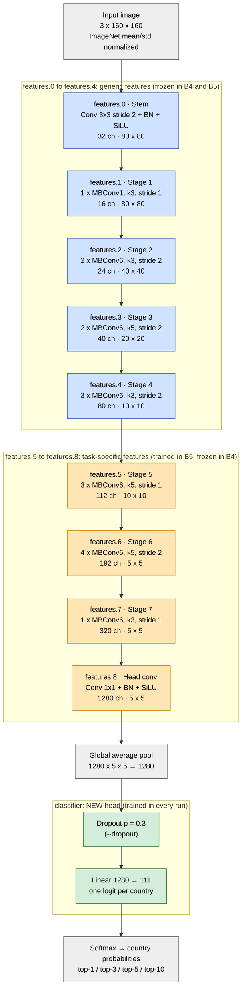
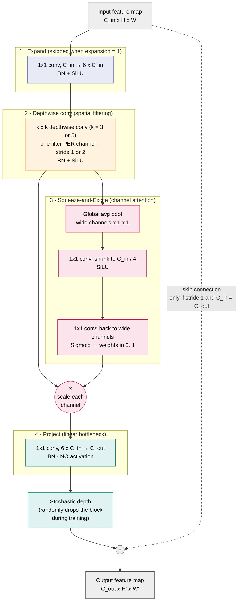
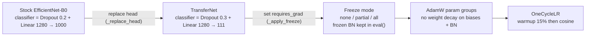

# EfficientNet-B0 architecture (as used in this project)

Source: `torchvision.models.efficientnet_b0` (ImageNet weights) wrapped by `TransferNet` in
`scripts/transfer/model.py`. Spatial sizes below are for our **160px sweep input**
(the final run uses 224px, so every size scales by 1.4×).

GitHub renders the Mermaid diagrams below directly. If they do not render, paste the code
into <https://mermaid.live>.

## Diagram 1: full pipeline

Colors show which parts are **frozen** in each experiment:
- **blue** = frozen in B5 (`--freeze partial`, `features.0`–`features.4`) and in B4
- **orange** = trained in B5; frozen in B4
- **green** = new head, trained in every run (random init)

**Counts (111-class head):** 16 MBConv blocks in total (1 + 2 + 2 + 3 + 3 + 4 + 1).
Blocks 1–8 sit in the frozen half, blocks 9–16 in the trained half.

| `--freeze` | What trains | Trainable params |
|---|---|---|
| `none` | everything | 4.15M |
| `partial` | `features.5`–`features.8` + classifier | 3.84M |
| `all` | classifier only (1280 × 111 + 111) | 0.14M |

Most of the weights are in the late stages (wide channels), which is why `partial`
freezing still leaves 3.84M of the 4.15M trainable.

## Diagram 2: one MBConv block (the building block, 16 per network)

MBConv = **inverted bottleneck** (narrow → wide → narrow) + **squeeze-and-excite** + residual.
Example: `MBConv6` with input channels `C_in`, output channels `C_out`, expansion ×6.

### Why each step exists (for Q&A)

| Step | What it does | Why it matters |
|---|---|---|
| 1x1 **expand** (×6) | Widens channels so the block can mix information in a rich space | The cheap 1x1 conv is where most learning happens |
| **Depthwise** k×k | Filters each channel on its own, with no mixing across channels | Costs about `k²·C` instead of `k²·C²` of a normal conv, so it is far fewer FLOPs for similar accuracy |
| **Squeeze-and-excite** | Pools each channel to one number, a tiny MLP turns that into a 0–1 weight per channel, and the weights rescale the channels | The network learns *which channels matter for this image* (e.g. "road marking" detectors for this photo) |
| 1x1 **project**, no activation | Shrinks back to a narrow `C_out` | Linear bottleneck: a nonlinearity in the narrow space would destroy information |
| **Skip connection** | Adds the input to the output when shapes match | Same reason as ResNet: easier gradient flow, so deep stacks train |
| **Stochastic depth** | Randomly skips whole blocks in training | Regularization (torchvision uses 0.2 for B0 on ImageNet) |

**Inverted bottleneck vs ResNet bottleneck:** ResNet goes wide → narrow → wide (the
skip connects the *wide* ends). MobileNetV2/EfficientNet goes narrow → wide → narrow (the
skip connects the *narrow* ends, so the thing stored between blocks is small and cheap).

## Diagram 3 (optional): where our changes plug in

## Compound scaling (EfficientNet's main idea, one paragraph for the report)

Earlier CNNs scaled up only one thing (depth, width or resolution). EfficientNet scales all
three together with one coefficient. B0 is the baseline found by neural architecture search,
and B1–B7 are the same network scaled up. We use **B0** because it has about 4M parameters,
which fits the T4 and the time we have, and because it reaches ImageNet accuracy comparable
to ResNet-50 with roughly 5× fewer parameters.
